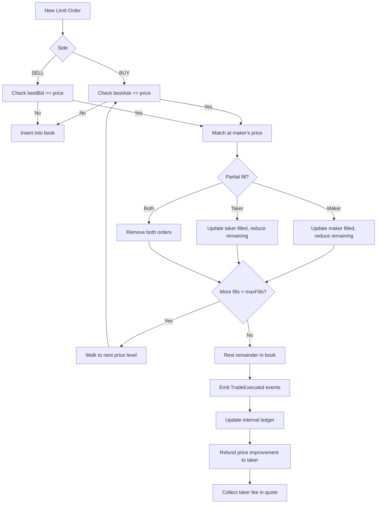

# YOLOfi Architecture

## System Overview

```mermaid
graph TB
    subgraph "Frontend (React + Vite + viem)"
        UI[User Interface]
        WB[WalletButton]
        FT[Faucet]
        DP[DepositPanel]
        OF[OrderForm]
        OBV[OrderBookView]
        MO[MyOrders]
        TF[TradeFeed]
    end

    subgraph "Smart Contracts (OrderBook.sol)"
        OBook[OrderBook Contract]
        Ledger[(Internal Ledger)]
        OB[Order Storage]
        PL[Price Levels]
        ME[Matching Engine]
        FC[Fee Collector]
    end

    subgraph "Tokens"
        tYBTC[tYBTC MockERC20]
        tUSDC[tUSDC MockERC20]
    end

    subgraph "Base Sepolia (Chain ID 84532)"
        RPC[RPC Endpoint]
        Explorer[Basescan Explorer]
    end

    %% Frontend connections
    UI --> WB
    UI --> FT
    UI --> DP
    UI --> OF
    UI --> OBV
    UI --> MO
    UI --> TF

    %% Wallet connection
    WB -.->|MetaMask| RPC

    %% Contract interactions
    WB -->|connect/disconnect| RPC
    FT -.->|mint/faucet| tYBTC
    FT -.->|mint/faucet| tUSDC
    DP -.->|deposit/withdraw| tYBTC
    DP -.->|deposit/withdraw| tUSDC
    DP -.->|deposit/withdraw| OBook
    OF -.->|placeLimitOrder| OBook
    MO -.->|cancelOrder| OBook
    MO -.->|getUserOrders| OBook
    OBV -.->|getTopLevels/getSpread| OBook
    TF -.->|getLogs TradeExecuted| OBook

    %% Contract internal
    OBook -->|read/write| Ledger
    OBook -->|read/write| OB
    OBook -->|read/write| PL
    OBook -->|match| ME
    OBook -->|collect fees| FC
    OBook -->|transfer| tYBTC
    OBook -->|transfer| tUSDC

    %% Token interactions
    tYBTC -->|ERC20| RPC
    tUSDC -->|ERC20| RPC

    %% Events
    OBook -.->|Events: OrderPlaced, TradeExecuted, etc.| OBV
    OBook -.->|Events: TradeExecuted| TF

    %% Styling
    classDef frontend fill:#e3f2fd,stroke:#1976d2,stroke-width:2px;
    classDef contract fill:#fff3e0,stroke:#f57c00,stroke-width:2px;
    classDef token fill:#f3e5f5,stroke:#7b1fa2,stroke-width:2px;
    classDef chain fill:#e8f5e9,stroke:#388e3c,stroke-width:2px;

    class UI,WB,FT,DP,OF,OBV,MO,TF frontend;
    class OBook,Ledger,OB,PL,ME,FC contract;
    class tYBTC,tUSDC token;
    class RPC,Explorer chain;
```

## Component Details

### Frontend (React + Vite + viem)

| Component | Responsibility | Key Hooks |
|-----------|---------------|-----------|
| `WalletButton` | MetaMask connection, network switching | `useWallet` |
| `Faucet` | Mint test tokens (tYBTC/tUSDC) | `useWallet`, `erc20Faucet`, `erc20Mint` |
| `DepositPanel` | Deposit/withdraw tokens, show balances | `useWallet`, `useBalances` |
| `OrderForm` | Place limit orders with validation | `useWallet`, `useBalances`, `placeLimitOrder` |
| `OrderBookView` | Display bids/asks with depth bars | `useBook` |
| `MyOrders` | List open orders with cancel | `useWallet`, `useBalances` |
| `TradeFeed` | Live trade history with filters | `useTrades` |

### Smart Contract (OrderBook.sol)

| Component | Purpose |
|-----------|---------|
| **Internal Ledger** | Tracks `baseFree`, `baseLocked`, `quoteFree`, `quoteLocked` per user |
| **Order Storage** | `Order` structs with FIFO linked lists per price level |
| **Price Levels** | Sorted doubly-linked list per side (bestBid/bestAsk pointers) |
| **Matching Engine** | Price-time priority, maker price, partial fills, price improvement |
| **Fee Collector** | Accrues taker fee in quote to `feeBalance` |

### Price/Amount Units

- **Price**: Quote smallest-units per 1e18 base units (e.g., 65,000 USDC per tYBTC = 65,000 * 10⁴)
- **Amount**: Base smallest units (tYBTC = 18 decimals, tUSDC = 6 decimals)
- **Tick Size**: 10⁴ (0.01 USDC per 1e18 base)
- **Lot Size**: 10¹⁴ (0.0001 tYBTC)
- **Min Order Size**: 10¹⁴ (0.0001 tYBTC)
- **Quote Amount Calculation**: `quoteAmount = amount * price / 1e18` (exact due to tick*lot % 1e18 == 0)

### Events (Verifiable History)

| Event | Parameters | Indexed |
|-------|------------|---------|
| `Deposited` | user, token, amount | user, token |
| `Withdrawn` | user, token, amount | user, token |
| `OrderPlaced` | orderId, owner, side, price, amount | orderId, owner |
| `OrderCancelled` | orderId, owner, remaining | orderId, owner |
| `TradeExecuted` | makerOrderId, takerOrderId, maker, taker, price, amount, fee, timestamp | makerOrderId, takerOrderId, maker |
| `FeeCollected` | amount | - |

### Matching Logic

### Invariants (Tested via Foundry Invariant Testing)

1. **Token Conservation**: `base.balanceOf(book) == Σ(baseFree + baseLocked)`
2. **Quote Conservation**: `quote.balanceOf(book) == Σ(quoteFree + quoteLocked) + feeBalance`
3. **Locked = Open Orders**: Locked amounts exactly match open order requirements
4. **No Crossed Book**: `bestBid < bestAsk` whenever both exist
5. **No Overfill**: `order.filled ≤ order.amount` for all orders